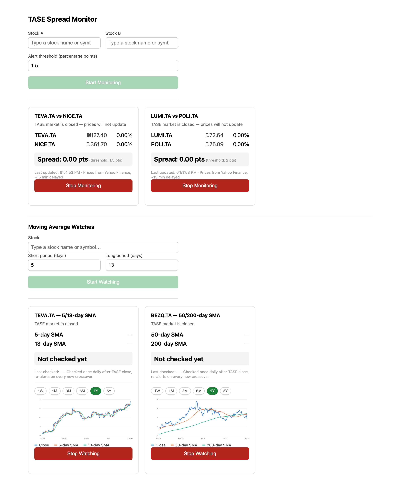
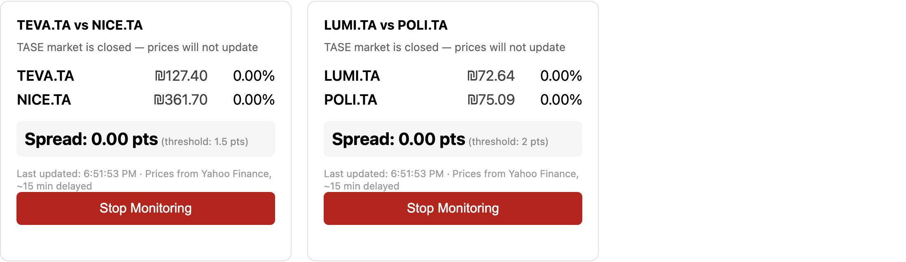
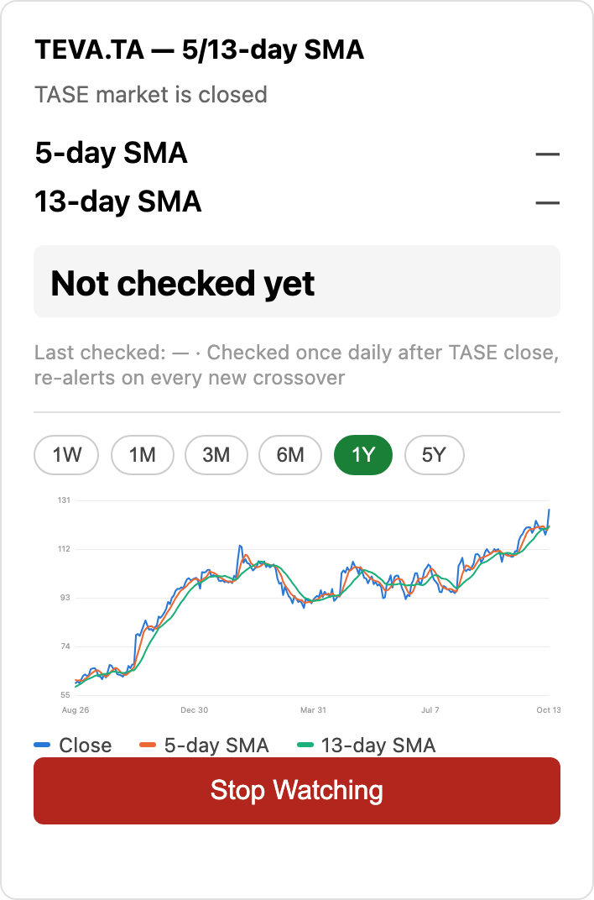
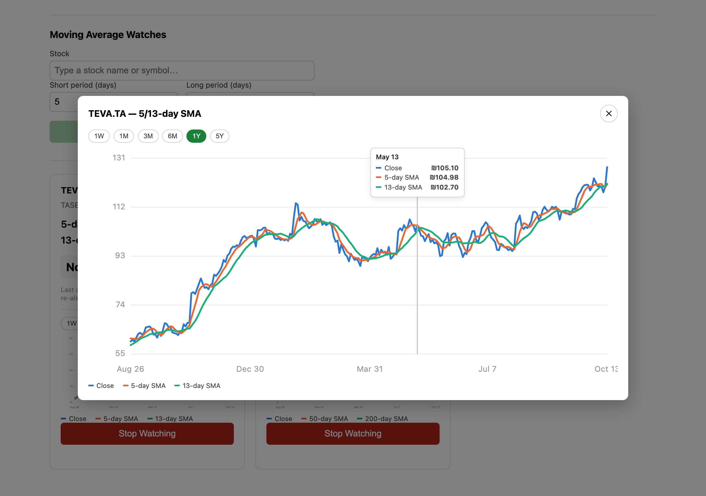
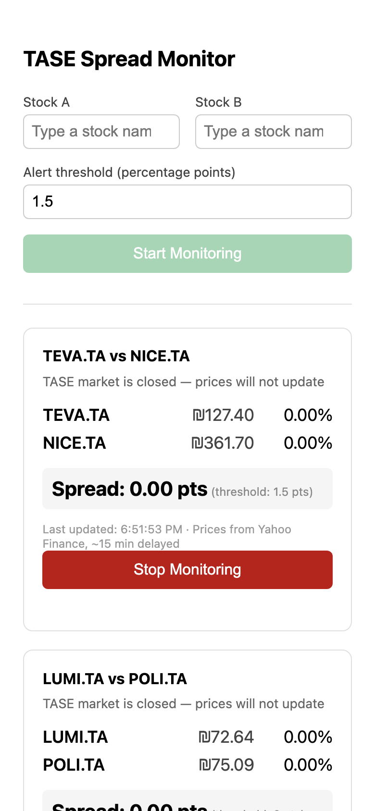

# TASE Spread Monitor

A small web app for keeping an eye on Tel Aviv Stock Exchange (TASE) stocks and getting an email when something worth acting on happens. It is for monitoring only. It does not place trades.

It does two things:

- **Pair-spread monitoring.** Pick two stocks and an alert threshold. The app tracks how far apart their price moves are, starting from 0% when you press *Start Monitoring*, and emails you once the gap crosses the threshold.
- **Moving-average watches.** Pick one stock and two moving-average periods (default 5 and 13 days). After each trading day closes, the app checks whether the short average crossed above the long one (golden cross) or below it (death cross), and emails you on every new crossover. Each watch includes a price chart with both averages drawn on it.



## Features

### Pair-spread monitoring



- Run as many pairs at once as you like. Each pair is independent.
- Each card shows both stocks' current price in ₪, their % change since you started, and the spread between them.
- Each pair sends one alert email when its spread crosses the threshold. To be alerted again, stop the pair and start a new one.
- Stocks come from the TA-125 index (119 tickers) and can be searched by symbol or company name.
- Prices are checked roughly every 45 seconds during TASE trading hours. The TASE calendar is built in, including the Monday–Friday week, shortened Friday sessions, and holidays.

### Moving-average watches and chart

<p>
  
</p>

- Short and long SMA periods are configurable per watch, for example 5/13 or 50/200.
- Each watch is checked once per trading day, a short while after TASE closes, and alerts on every new golden or death cross.
- The chart shows the daily closing price plus both SMA lines. Pick a range (1W, 1M, 3M, 6M, 1Y or 5Y) and hover to read exact values. The range you choose is remembered after you reload the page.
- Click any chart to open a larger view:



### Works on a phone

<p>
  
</p>

## Running it on Windows (non-technical setup)

The easiest way to run the app on a Windows PC is the included launcher. See **[WINDOWS-SETUP.txt](WINDOWS-SETUP.txt)** for step-by-step instructions. Once setup is done, you start the app by double-clicking `Start-TASE-Monitor.bat`, and it opens in your browser at `http://127.0.0.1:8099`.

## Running it for development

Requirements: Python 3.11+ and Node.js.

**1. Email settings.** Copy `backend/.env.example` to `backend/.env` and fill in your SMTP details. For Gmail, use an [App Password](https://support.google.com/accounts/answer/185833), not your normal password. Never commit `backend/.env`; it is git-ignored.

```
SMTP_HOST=smtp.gmail.com
SMTP_PORT=587
SMTP_USERNAME=your-account@gmail.com
SMTP_PASSWORD=your-gmail-app-password
ALERT_FROM_EMAIL=your-account@gmail.com
ALERT_TO_EMAIL=where-alerts-go@example.com
```

**2. Backend** (from `backend/`):

```bash
python -m venv .venv
.venv/bin/pip install -e ".[dev]"
.venv/bin/uvicorn app.main:app --host 127.0.0.1 --port 8099
```

**3. Frontend** (from `frontend/`), in a second terminal:

```bash
npm install
npm run dev
```

Open `http://localhost:5173`. The dev server forwards `/api` requests to the backend on port 8099.

**Production-style single process:** run `npm run build` in `frontend/`. The backend then serves the built site from `frontend/dist/` along with the API, all on `http://127.0.0.1:8099`.

**Sending a test email:** from `backend/`, run `.venv/bin/python -m scripts.force_alert_test`. It sends one real alert email, so you can check your SMTP settings without waiting for a real threshold crossing.

## Tests and checks

```bash
cd backend
.venv/bin/python -m pytest                       # backend test suite
.venv/bin/python -m pyflakes app scripts tests   # lint (pip install pyflakes first)

cd ../frontend
npx tsc --noEmit                                 # type check
npm run lint                                     # oxlint
```

## How it's built

| Part | What it uses |
|---|---|
| Backend | FastAPI (Python), two background `asyncio` pollers: one for pair-spreads, one for moving averages |
| Market data | [yfinance](https://github.com/ranaroussi/yfinance) (free Yahoo Finance data, about 15 minutes delayed), kept behind a `MarketDataProvider` interface so a different data source can be swapped in later |
| Storage | SQLite (`backend/data/app.db`), so active sessions and watches survive a restart |
| Email | Plain SMTP |
| Frontend | React + TypeScript + Vite; the charts are hand-drawn SVG with no charting library |

```
backend/
  app/
    market_data/       Yahoo Finance access (the only code that talks to yfinance)
    trading_calendar/  TASE trading hours and holidays
    session.py         pair-spread sessions
    poller.py          pair-spread background checker
    alerts/            pair-spread alert email
    ma/                moving-average watches: state, daily poller, email, chart data, API
  tests/
  scripts/             one-off tools (ticker resolution, data checks, test email)
frontend/
  src/
    components/        cards, forms, stock search, chart, range selector, chart modal
    hooks/             polling the backend every few seconds
```

For deeper architecture notes and the design decisions behind them, see [CLAUDE.md](CLAUDE.md).

## Limitations

- **Prices are delayed about 15 minutes.** Yahoo Finance's free data is not real-time, so don't use this app for time-critical trading decisions.
- **Yahoo Finance is unofficial.** yfinance scrapes Yahoo, so data can occasionally be missing or late. The app retries and shows an error on the card rather than crashing.
- **The holiday list needs a yearly update.** `backend/app/trading_calendar/holidays.py` should be checked against TASE's official calendar each year.
- **Single user.** There are no accounts or logins, so run the app only on your own machine or a private server.
